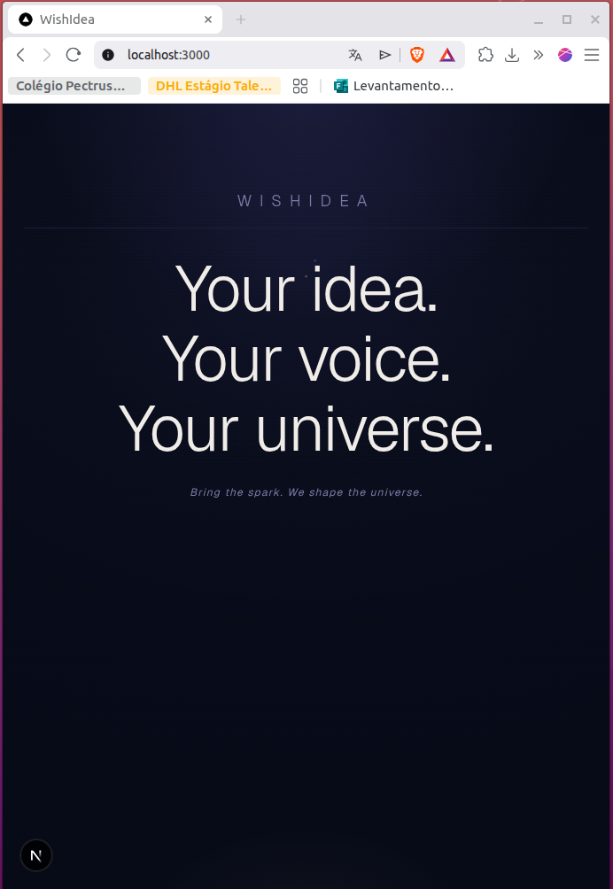
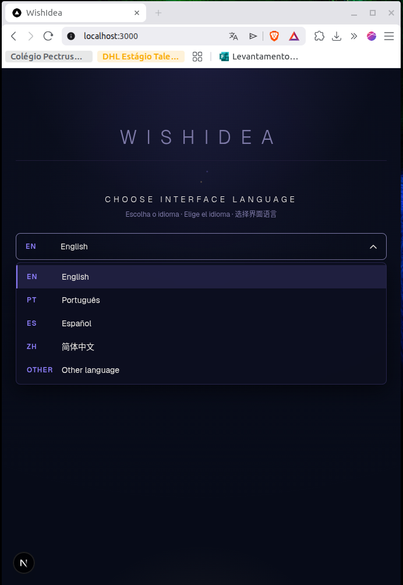
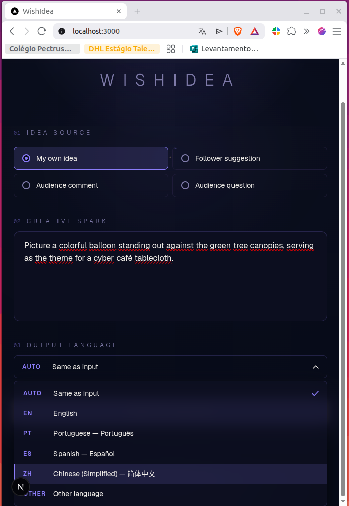
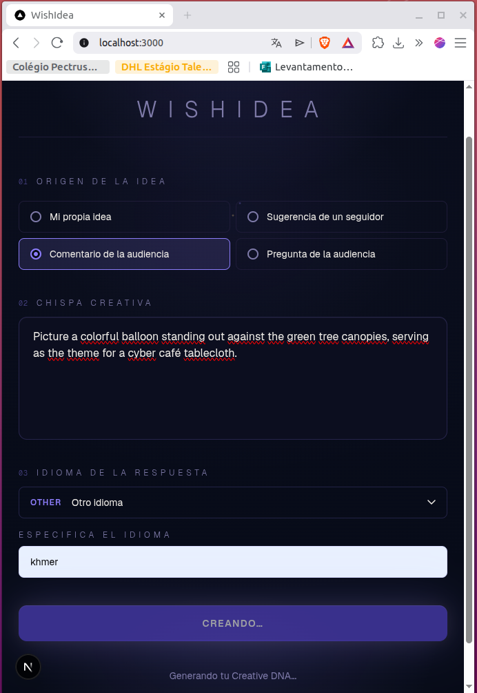
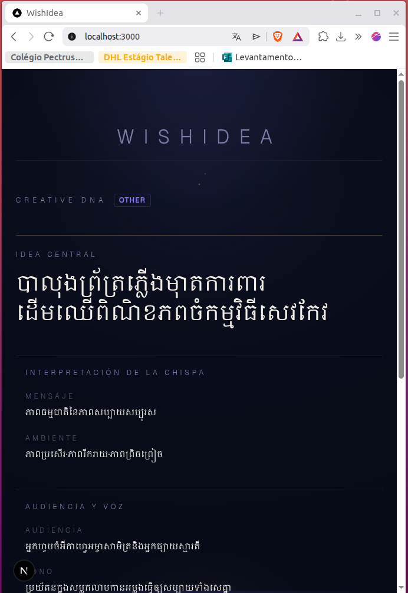
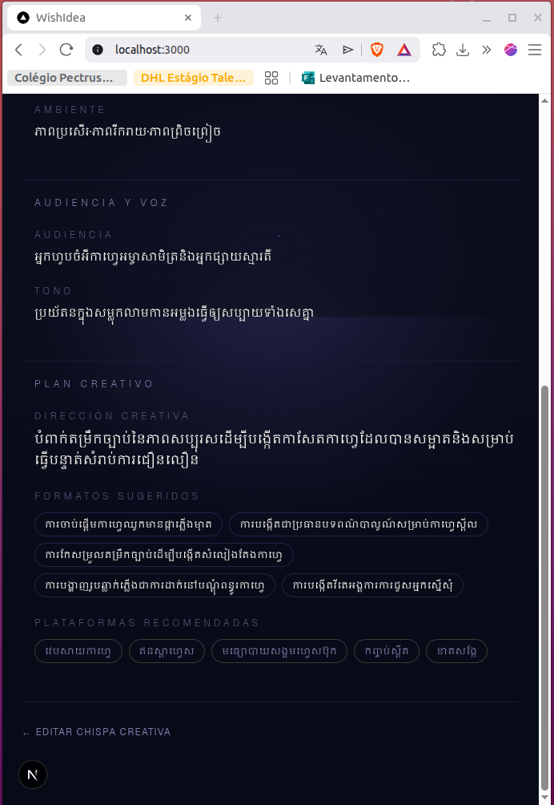

# WishIdea

> Your idea. Your voice. Your universe.



WishIdea is an AI-assisted creative ideation platform built for the **AI Builders Challenge with IBM Bob — July 2026**.

It helps creators turn an initial spark, wish, suggestion, or rough concept into structured creative directions for formats such as video, live/streaming, music/audio, and stories/scripts. The goal is not to replace the creator, but to help bridge the gap between **“I have an idea”** and **“How can I develop it?”** while keeping the user in control of the creative process.

## Challenge

**AI Builders Challenge with IBM Bob — July 2026**

**Selected theme:** Reimagine Creative Industries with AI

WishIdea aligns with the challenge by using AI as a creative partner for ideation, brainstorming, and structured concept development.

## Project Name Evolution

The project started under the name **WishCraft** during the first development iterations.

During development, the name was changed to **WishIdea** to give the project a more distinctive identity and to better reflect its purpose: helping users develop their own ideas instead of positioning AI as the final creator.

Some early development history, screenshots, or references may therefore still show the former name **WishCraft**. The current project name is **WishIdea**.

## Problem Statement

Creators often have an initial idea but struggle with the next step: turning that idea into a concrete creative direction.

This gap can appear when preparing:

- short-form videos;
- live or streaming content;
- music or audio concepts;
- stories and scripts;
- social-media content;
- other creative formats.

Traditional generative AI tools can quickly return a finished answer, but that can reduce the creator's participation in the ideation process.

WishIdea focuses on a different role for AI: **creative assistance and structured brainstorming**.

## Solution

WishIdea receives a creative spark from the user and uses AI to transform it into structured creative possibilities.

The current prototype allows the user to:

- choose a creative origin or content format;
- describe a creative spark;
- choose the desired output language;
- request AI-assisted creative direction;
- receive a structured **Creative DNA** response;
- use the generated directions as a starting point for further human creation.

The application is designed around the principle that the user remains the creative decision-maker.

## How to Use WishIdea

1. Choose the interface language.
2. Select where the creative spark comes from:
   - My own idea
   - Follower suggestion
   - Audience comment
   - Audience question
3. Describe your creative spark.
4. Select the desired output language, or keep **Same as input**.



5. Generate the Creative DNA.
6. Review the AI-assisted creative direction, including:
   - Core Idea
   - Message
   - Mood
   - Audience
   - Tone
   - Creative Direction
   - Suggested Formats
   - Recommended Platforms
7. Use, adapt, combine, or reject the suggestions. The creator remains in control of the final direction.



## How It Works

1. The user selects a creative format.
2. The user enters an initial idea, wish, prompt, or suggestion.
3. The user selects the desired response language.
4. The Next.js application sends the request to its server-side API.
5. The API authenticates with IBM watsonx.ai.
6. The configured AI model generates a structured creative response.
7. WishIdea validates and returns the result to the interface.
8. The user decides how to continue, adapt, combine, or reject the suggestions.



-



## AI Approach and Architecture

WishIdea uses AI as a core functional component.

The application follows a server-side integration pattern so that IBM watsonx.ai credentials remain outside the browser.

```text
User
  |
  v
WishIdea Interface
Next.js / React
  |
  v
Next.js API Routes
  |
  +--> Interface-language handling
  |
  +--> Creative DNA request processing
  |
  v
IBM watsonx.ai
  |
  v
Configured foundation model
(WATSONX_MODEL_ID)
  |
  v
Structured creative response
  |
  v
Validation and presentation to the user
```

The AI model is configured through environment variables rather than hard-coded into the repository.

## IBM Technologies

### IBM Bob

IBM Bob was used as the primary AI-assisted development tool during the implementation and troubleshooting of the project.

### IBM watsonx.ai

WishIdea integrates with IBM watsonx.ai as the AI inference platform used by the application's server-side API.

The model is configured through:

```text
WATSONX_MODEL_ID
```

This keeps the implementation flexible without exposing the model configuration in the client.

## How IBM Bob Was Used

IBM Bob supported the project throughout implementation and debugging.

Examples of work performed with IBM Bob include:

- analyzing the existing Next.js codebase;
- planning and applying code changes;
- implementing and refining the `Creative DNA` API flow;
- troubleshooting IBM watsonx.ai integration;
- diagnosing API and schema-validation failures;
- correcting structured-response handling;
- implementing interface-language handling;
- reviewing proposed edits before applying them;
- supporting iterative debugging while the prototype was running locally.

IBM Bob was used directly in the development environment alongside the running application.

The project was initially developed as **WishCraft** and later renamed to **WishIdea**. Because of this rename, some early IBM Bob development sessions may reference the former project name.

## Tech Stack

- **Next.js**
- **React**
- **TypeScript**
- **JavaScript**
- **HTML / CSS**
- **IBM Bob**
- **IBM watsonx.ai**
- **Node.js / npm**
- **Git / GitHub**

## Main Application Areas

```text
app/
├── api/
│   ├── creative-dna/
│   │   └── route.ts
│   └── interface-language/
│       └── route.ts
├── globals.css
├── layout.tsx
└── page.tsx
```

### `app/page.tsx`

Main user interface and interaction flow.

### `app/api/creative-dna/route.ts`

Server-side route responsible for processing Creative DNA requests and communicating with IBM watsonx.ai.

### `app/api/interface-language/route.ts`

Server-side route used for interface/output-language handling.

## Current Prototype

The July Challenge submission is a working prototype / proof of concept.

The current implementation demonstrates:

- a functional web interface;
- multiple creative-format options;
- multilingual output selection;
- server-side AI integration;
- IBM watsonx.ai inference;
- structured Creative DNA generation;
- validation and error handling;
- development and troubleshooting with IBM Bob.

## Run Locally

### Requirements

- Node.js
- npm
- IBM watsonx.ai project credentials

### Install dependencies

```bash
npm install
```

### Configure environment variables

Create a local `.env.local` file:

```env
WATSONX_API_KEY=
WATSONX_PROJECT_ID=
WATSONX_URL=
WATSONX_MODEL_ID=
```

Do not commit real API keys or credentials to GitHub.

### Start the development server

```bash
npm run dev
```

Then open:

```text
http://localhost:3000
```

## Environment Variables

| Variable | Purpose |
| --- | --- |
| `WATSONX_API_KEY` | IBM Cloud / watsonx.ai authentication |
| `WATSONX_PROJECT_ID` | watsonx.ai project identifier |
| `WATSONX_URL` | watsonx.ai service endpoint |
| `WATSONX_MODEL_ID` | AI model configured for generation |

## Security

Credentials are loaded from environment variables and should never be committed to the repository.

Before publishing or sharing the project, confirm that:

- `.env.local` is ignored by Git;
- no API keys are present in source files;
- screenshots and demo recordings do not expose secrets.

## Challenge Submission

This repository was prepared for the **AI Builders Challenge with IBM Bob — July 2026**.

Submission components include:

- working prototype / proof of concept;
- IBM Bob as the primary development tool;
- IBM SkillsBuild learning completion;
- public GitHub repository;
- project documentation;
- public demo/presentation video of up to 3 minutes;
- published challenge project page.

## Demo

Demo video: https://youtu.be/Pt1WfpbaZMs

## Author

**André Luiz Barbosa**

GitHub: [Andrehlb](https://github.com/Andrehlb)
